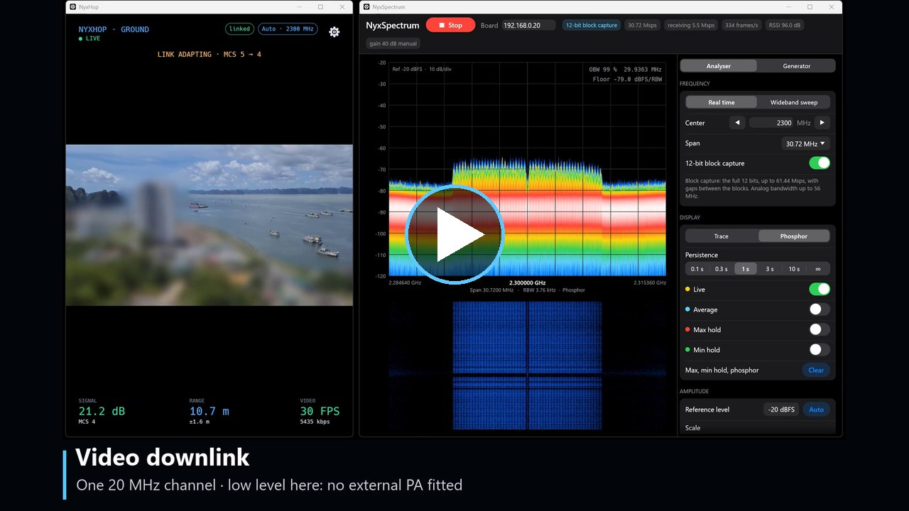

# NyxHop

**A frequency-hopping video and data link for drones and robots. The whole modem runs in an FPGA;
the channels are yours, anywhere from 70 MHz to 6 GHz.**


[](docs/img/nyxhop-demo.mp4)

*Two minutes: the video and control links on a spectrum analyser, live video, an LTE
jammer on the video channel and the link moving away from it, 48 Mbit/s, the four channel widths
and an IP network over the radio.*

## What it does

* **Up to 48 Mbit/s** between two ADRV9364 boards in a 20 MHz channel. Channels of 10, 5 and
  2.5 MHz reach farther at a lower rate; the link narrows by itself in a fade and widens again.
* **Leaves interference by itself.** Jam the channel in use and the link moves to a clean one,
  with no operator action.
* **Two links in one**: a wide downlink for video and data, and a narrow control uplink that hops
  on channels of its own.
* **Your channels**: any frequencies from 70 MHz to 6 GHz, several bands in one table. No fixed,
  well-known frequencies for a detector or a jammer to aim at.
* **Paired ends**: an aircraft answers only the ground station it was paired with.
* **Distance without GPS**: the link measures the distance between its two ends from its own
  signal.
* **Non-Chinese if you need it**: Analog Devices radios, AMD (Xilinx) FPGAs, our own software.
* **Free on a PlutoSDR**: no licence, no time limit, no sign-up.

## What you can send

| | |
|---|---|
| **Video** | A USB camera, an IP camera (RTSP), a phone camera or a video file, at 30 fps; the bitrate follows the link. An IP camera can plug straight into the aircraft board, with no computer on board. |
| **Telemetry** | MAVLink both ways over a UDP pipe: ground UDP 14555 to aircraft 14556, aircraft 14557 to ground 14558. Point your ground control station and your flight controller at it. [Details](docs/telemetry-sdk.md). |
| **Data** | Your own protocol with the Rust SDK (`link/nyx-proto`, `link/nyx-link`): bytes in at one end, out at the other. |
| **IP network** | Two networks joined over the radio, next to the video: ping, SSH, web, file copies, iperf3, IP cameras. About 24 Mbit/s from the aircraft to the ground and 1.5 Mbit/s back. |

## Getting started

You need two boards (ADRV9364-Z7020 or PlutoSDR, in any mix), antennas for your band, and a PC
on the same network with Python 3 (`pip install paramiko`) and Rust 1.85 or newer. For a first
test, put the boards 1 to 3 m apart.

**1. An OS on the board.** ADRV9364: write ADI's *Kuiper Linux 2023_r2* to a microSD card
(configuration `adrv9364z7020_lvds`), boot it with Ethernet plugged in, and find its address on
your router (user `root`, password `analog`). PlutoSDR: nothing to do.

**2. NyxHop on the board.** From the repository root:

```bash
set BOARD_PW=analog          # PowerShell: $env:BOARD_PW = "analog"
python link/scripts/nyx_flash.py --host 192.168.0.10 --role tx     # aircraft (camera side)
python link/scripts/nyx_flash.py --host 192.168.0.11 --role rx     # ground (screen side)
python link/scripts/nyx_pluto.py --pair                            # or: two PlutoSDRs on this PC's USB
```

The board restarts and runs NyxHop at every power-up from then on. Run the same command again
to update it; tables, pairing and licence are kept. `nyx_flash.py --scan` finds your boards.

**3. The app.** `cargo build --release`, then run `nyxhop` on each computer. It asks which end
this computer is (**Ground station** or **Aircraft**) and the board's address. In the ground
app press **Link aircraft** once to pair the two boards; the video appears on the ground screen.
Everything else is in the settings drawer (the gear, or `H`): the video source, your channel
tables (*Auto* picks the best channel, *Off* holds one), the channel width, the radio.

**4. The licence.** See [below](#licence): the first 100 hours of running are free, and so is a
licence for your first ten boards.

### IP network over the link

```bash
python link/scripts/nyx_ip.py on  --air 192.168.0.10 --ground 192.168.0.11
```

The aircraft board becomes the gateway of `192.168.10.0/24` and the ground board of
`192.168.20.0/24`. Give a computer on each side an address there (`192.168.10.50`, gateway
`192.168.10.1`; `192.168.20.50`, gateway `192.168.20.1`) and use them like two computers on one
network: everything between them crosses the radio. `nyx_ip.py off` stops it.

### Measuring the link

`nyx-bitrate` measures what your link carries: the aircraft board sends test packets, the ground
board counts them, and the window shows the rate, the loss and the SNR. **Sweep** fills a table
with every rate at every channel width. Take it to the field to get the numbers for your
antennas, your band and your distance.

### If something is off

* **The app does not connect**: ping the board; `nyx_flash.py --scan` lists the boards it finds.
* **No video**: both pills must say *linked* (press **Link aircraft** again); a pill saying
  *locked* means that board's free hours are used up and it needs its licence.
* **Video stutters**: look at the SNR; under 15 dB, check antennas, distance and band.
* **More detail**: the board console is TCP 7202 (`hop status`, `license`), and the apps write
  logs next to the program in `logs/`.

## Licence

**PlutoSDR: free.** No licence, no time limit, commercial use included.

**ADRV9364-Z7020: 100 running hours free, then a licence** (ANTSDR E200: 20 running hours). Only
the time the board is switched on and running NyxHop counts; a board that is switched off counts
nothing, so a board left in a drawer for a month has used none of its hours. 100 hours is, for
example, 50 two-hour sessions.

A licence for your first ten boards is free, commercial use included, and never expires:

1. In the app connected to the board, open **Licence** and press **Copy** next to the board's DNA.
2. Request the licence at **[nyxhop.com/licence.html](https://nyxhop.com/licence.html)**; it comes
   back on the page at once.
3. Paste it into the box and press **Apply here**. The pill turns *licensed*.

Each board needs its own licence. More boards or later feature generations:
**contact@tacitek.com**. Details in [docs/license.md](docs/license.md).

## Tailored to your system

This repository is where we start. Write to **contact@tacitek.com** and we fit the link to what
you are building:

* the waveform, the channel width and the data rate;
* the frequency plan, the hopping pattern and how the link handles interference;
* the control link, telemetry and IP interfaces;
* delivered as an FPGA modem for your hardware, your amplifiers and your antennas.

## Hardware

| FPGA board | FPGA | transceiver | status |
|---|---|---|---|
| ADRV9364-Z7020 | Zynq-7020 | AD9364 | current radio |
| PlutoSDR | Zynq-7010 | AD9363 | current radio, free |
| ANTSDR E200 | Zynq-7020 | AD9361 | previous radio: pairs with another E200 |

An ADRV9364 and a PlutoSDR pair in any mix, and any board can be either end. Range depends on
the amplifiers and antennas at each end:

| RF chain at each end | band | video | link held |
|---|---|---|---|
| 0.5 W amplifier, LNA | 2.4 GHz | 13 km | 23 km |
| 0.5 W amplifier, LNA | 5.8 GHz | 5.5 km | 9.5 km |
| 1 W amplifier, LNA | 2.4 GHz | 18 km | 32 km |
| 1 W amplifier, LNA | 5.8 GHz | 7.5 km | 13 km |

*Calculated range, line of sight.* You are responsible for the frequencies and the power you
transmit under the rules of your country.

## Repository layout and licensing

```
link/         protocol, framing, app support, board console, the tools (nyx_flash, nyx_pluto, nyx_ip)
apps/         nyxhop (the app for either end), nyx-bitrate (the link meter), video, data
deploy/       prebuilt board images and programs you flash
docs/         licence terms, telemetry and SDK, legal
```

| what | licence |
|---|---|
| Source code: `link/`, `apps/`, `docs/` | public domain ([Unlicense](LICENSE)) |
| Board images and programs in `deploy/` (except `deploy/ipcam/`) | [EULA](docs/EULA.md) |
| `deploy/ipcam/`: a build of `apps/video/nyx-ipcam` | public domain |
| Third-party parts of the board images | their own licences, see [THIRD-PARTY.md](docs/THIRD-PARTY.md) |
