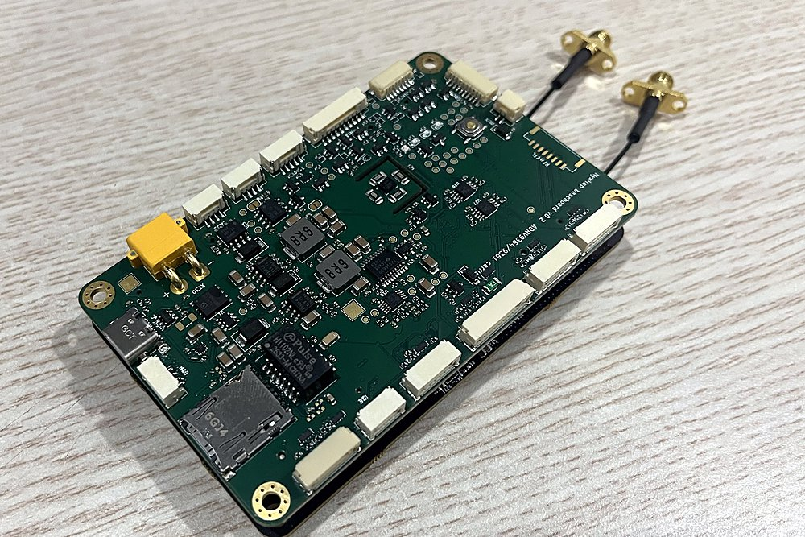
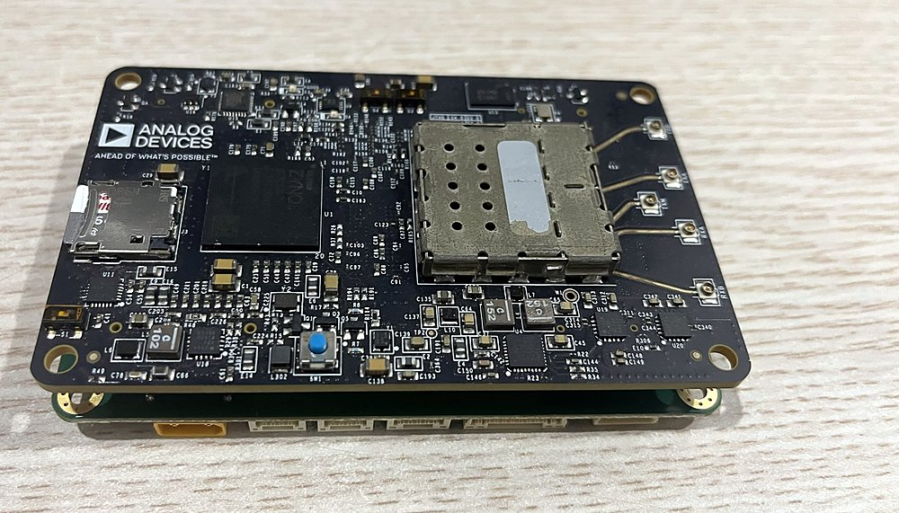

# NyxHop FC

The flight controller of the NyxHop board. PX4 runs on the board's Zynq, on the same chip as the
link, so there is no separate flight-controller board. The FPGA drives the IMU bus and the motor
outputs, DShot or PWM on each motor.

 

*The NyxHop board, 100 × 62 mm, with the radio module plugged in.*

## Install

On a NyxHop board that already runs the link (`../link/scripts/nyx_flash.py`) and the camera app
(`../link/scripts/nyx_ipcam_install.py`, which carries PX4's MAVLink over the link):

    python -m pip install paramiko
    python fc/install.py install <board address>

It puts the flight-controller image and PX4 on the board, checks every file, keeps the ones it
replaces, and reboots. The link runs as before, with PX4's MAVLink going over it to the ground
station, and the board's licence covers the flight controller too. `status` shows what runs;
`uninstall` puts the board back as it was and keeps PX4's parameters unless you add `--all`.
Flashing the link again takes the flight controller off: run `install` once more after it.

## Fly

NyxHop Pilot is the app for it: video, the flight data, a map and the sticks, all over the link.

    cargo build --release -p nyx-pilot
    target/release/nyxhop-pilot --board <ground board address>

Arm by holding the arm button for a second. Arrow keys roll and pitch, W/S throttle, A/D yaw,
T takes off, L lands, R returns home, H holds, M swaps the map and the video; a gamepad works too.
The map is OpenStreetMap, cached on disk, so places you have looked at once still show without a
network. Run it instead of the ground app, not beside it: both talk to the same board.

## What's here

| | |
|---|---|
| `install.py` | installs, removes and checks the flight controller on a board |
| `deploy/` | the board image: the link with the flight-controller I/O, PX4, the kernel and their start files |
| `px4-patches/` | PX4 v1.17.0: the board `nyxhop/zynq`, the `nyx_dshot` motor driver, a config for the NyxHop baseboard, and serial ports at rates Linux has no constant for (CRSF 420000) |
| `ardupilot-patches/` | ArduCopter 4.7.2: two fixes for the Zynq's ARM. GCC 10 at -O3 broke LOITER and POSHOLD through strict aliasing |
| `docker/` | the build image: Debian bullseye armhf, GCC 10 and glibc 2.31, the same as the board's Linux |
| `hardware/` | the NyxHop baseboard v0.2: schematic and ports |

## Build PX4 yourself

    git clone --branch v1.17.0 --recursive https://github.com/PX4/PX4-Autopilot.git
    cd PX4-Autopilot
    git checkout -b nyxhop
    git am ../fc/px4-patches/*.patch
    cd ..
    docker build -t nyxhop-armhf fc/docker
    docker run --rm -v "$PWD/PX4-Autopilot:/src" nyxhop-armhf make nyxhop_zynq_default

The build lands in `PX4-Autopilot/build/nyxhop_zynq_default/` (`bin/` and `etc/`). The configs are
in `boards/nyxhop/zynq/`; `nyxhop-bb.config` is the one for the NyxHop baseboard.

For ArduCopter:

    git clone --branch Copter-4.7.2 --recursive https://github.com/ArduPilot/ardupilot.git
    cd ardupilot
    git am ../fc/ardupilot-patches/*.patch

## Licence

- `deploy/`: the EULA (`../docs/EULA.md`), as the other board images. PX4 in it is BSD 3-Clause;
  the Linux kernel is GPLv2, built from ADI's kernel with `deploy/kernel.config`.
- `px4-patches/`: BSD 3-Clause, as PX4. `ardupilot-patches/`: GPLv3, as ArduPilot.
- The schematic is here so you can wire the board into your system.
- Everything else: public domain, as the rest of this repository.
