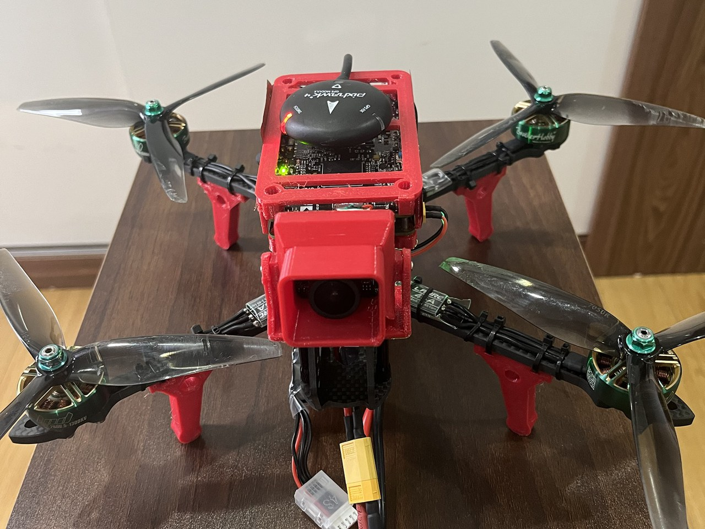
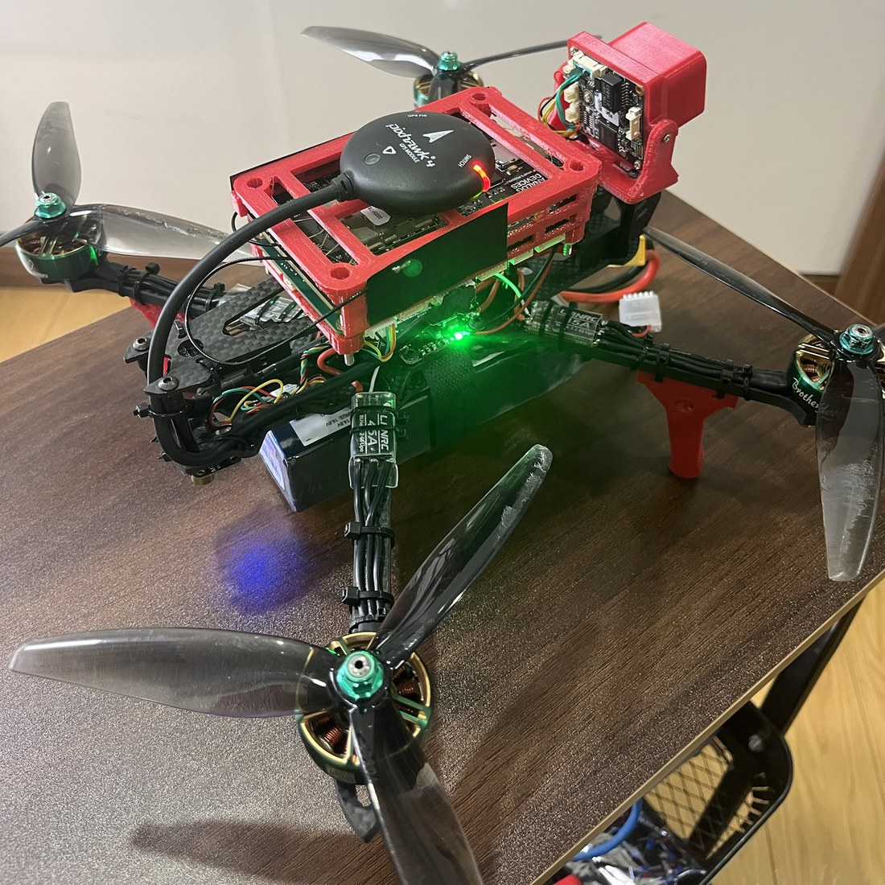
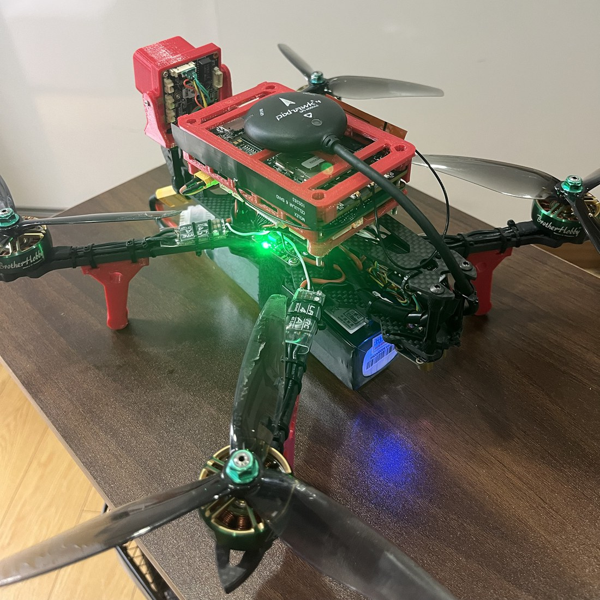
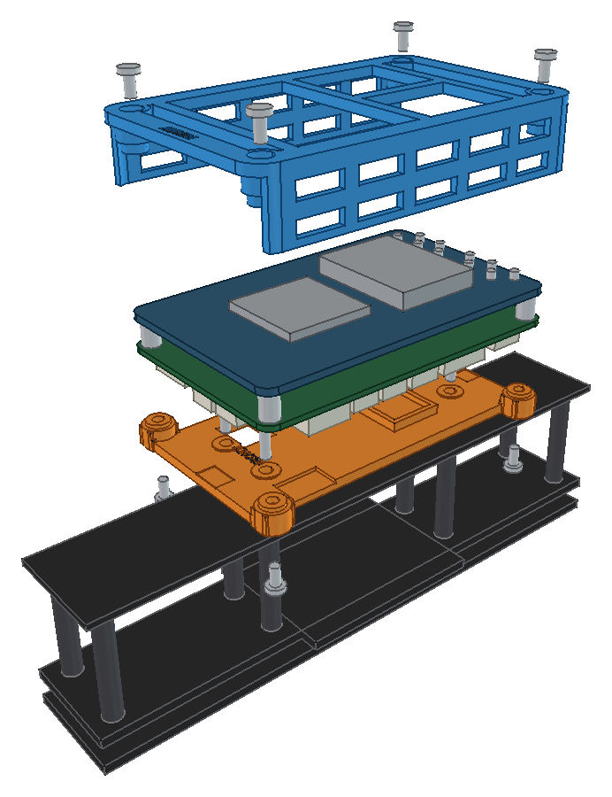
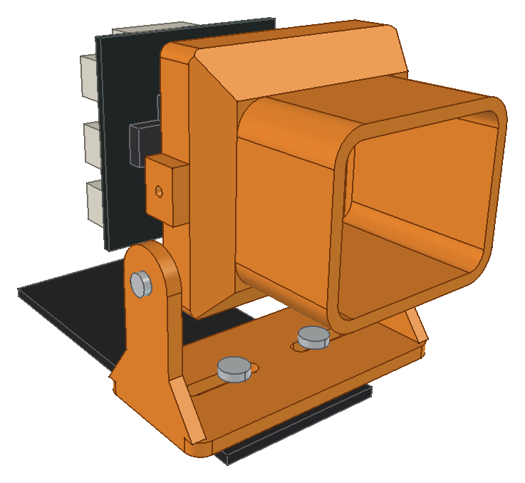
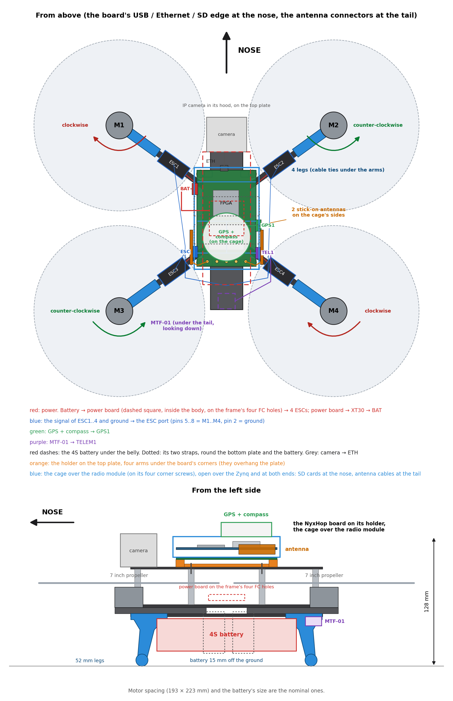

# NyxHop board on a Mark4 7-inch drone

The NyxHop board as the flight controller, the video link and the control link of a 7-inch quad:
what it is built from, how it is wired, the printed parts that hold the board and the camera, and
the PX4 configuration.

 

## Parts

| | | |
|---|---|---|
| Frame | Mark4 V2, 7 inch | motors 193 × 223 mm apart, M3 × 35 standoffs between the plates |
| Motors | 4 × 2806.5, 1300 KV | |
| ESCs | 4 × 45 A, BLHeli_S, 2S–6S | one on each arm |
| Propellers | 7 inch, three blades | two clockwise, two counter-clockwise |
| Battery | 4S LiPo, XT60 | under the belly, two straps |
| Power board | battery pads for four ESCs, a 12 V regulator for the camera | on the frame's 30.5 mm flight-controller holes, inside the body |
| NyxHop board | baseboard v0.2 with the ADRV9364-Z7020 radio module | flight controller, video link and control link |
| GPS and compass | Pixhawk 4 GPS module (u-blox M8N, IST8310) | its 10-pin plug fits GPS1 |
| Optical flow and range finder | MicoAir MTF-01 | under the tail, looking down |
| Camera | IP camera module on a 38 × 38 mm board, M12 lens, 12 V | H.264 over Ethernet |
| Antennas | two stick-on antennas for your bands, with U.FL cables | on the cage |
| Screws | 6 × M3 × 10 button head, 6 × M2 × 6 self-tapping | the board and the cage use the radio module's own eight M3 × 6 |
| Foam | two soft pads, 14 × 14 mm, 5 mm and 8 mm thick | under and over the IMU |
| Leads | XT30 lead 15 cm, JST-SH 8-pin, JST-GH 6-pin and 4-pin | power, ESC port, TELEM1, ETH |

With the battery it weighs 1.1 kg.

## Printed parts

Files in [print/](print/): the STL lies as it prints, the STEP sits where the part goes on the
aircraft. The holder, the cage, the legs and the hood print without supports.

| Part | File | Print | What it does |
|---|---|---|---|
| Holder | `holder` | PETG, one, flat side down | A flat plate on the top plate, on the four middle standoffs. Four corner posts carry the board 7.5 mm over the plate; a pocket under the IMU holds its foam pad. FRONT marks the nose end |
| Cage | `cage` | PETG or TPU 95A, one, top side down | Over the radio module, on its four upper screws. It takes the knock when the aircraft lands on its back, and carries the GPS and the antennas |
| Leg | `leg` | PETG or TPU 95A, four, lying on the side, 40–50 % infill | 52 mm under each arm, held by two cable ties |
| Camera hood | `camcap` | PETG, one, rim down | Holds the camera board by its four corner holes (34.5 mm apart). The hood stands 3 mm proud of the lens |
| Camera cradle | `camcradle` | PETG, one, base down | On the two nose standoffs of the top plate. The camera tilts in it from 20° down to 30° up |

 

The board is 62 mm wide and the top plate 34 mm, so the rows of connectors along the board's two
long edges hang clear of the plate on either side, and the board sits low: 128 mm from the ground
to the top of the cage.

## Where things go

- The board's Ethernet / USB / SD edge is at the nose, the radio module's antenna connectors at
  the tail.
- BAT and the ESC port are on the left side, GPS1 and TELEM1 on the right.
- The radio module is on top, in the air; the IMU is on the board's underside.

## Wiring

Power:

| From | To |
|---|---|
| Battery | power board |
| Power board, four ESC pad pairs | the four ESCs, any ESC on any pair |
| Power board, battery pads | the board's BAT (XT30), a 15 cm lead |
| Power board, 12 V regulator | camera, 12 V and ground |

Signals:

| Port on the board | Pin | To |
|---|---|---|
| ESC (JST-SH 8P) | 2 GND | the signal ground of the four ESCs |
| | 5 M1 | signal of the front-left ESC |
| | 6 M2 | front-right |
| | 7 M3 | rear-left |
| | 8 M4 | rear-right |
| GPS1 (GH 10P) | | the GPS module's plug |
| TELEM1 (GH 6P) | 1 5V, 2 TX, 3 RX, 6 GND | MTF-01: 5V, RX, TX, GND |
| ETH (GH 4P) | 1 TX+, 2 TX−, 3 RX+, 4 RX− | camera RX+, RX−, TX+, TX− |
| Radio module, U.FL | | the two antennas |

Pins 1, 3 and 4 of the ESC port stay empty. Twist each Ethernet pair and keep the lead short. Set
the MTF-01 to the Mav_PX4 protocol with its maker's tool before it goes on the aircraft. Plug
everything in with the battery off.

Motor 1 is front left and turns clockwise seen from above, 2 front right counter-clockwise, 3 rear
left counter-clockwise, 4 rear right clockwise.

## Assembly

1. Build the frame with the power board on the flight-controller holes and the ESCs on the arms.
2. Tie a leg under each arm, three quarters of the way out to the motor.
3. Take the four middle screws out of the top plate, put the holder on with FRONT to the nose, and
   fasten it into the standoffs with four M3 × 10.
4. Put the 5 mm foam pad into the holder's pocket. Put the 8 mm pad on the board over the IMU,
   between the board and the radio module: 59 to 69.5 mm from the Ethernet edge, 18 to 28.5 mm
   from the BAT edge.
5. Fasten the cage on the radio module with the module's four upper screws.
6. Take the module's four lower screws out, set the board on the holder's corner posts, and drive
   the same four screws back in from below through the posts. These four are all it takes to lift
   the board off again.
7. Screw the camera board into the hood from behind with four M2 × 6. Fasten the cradle on the two
   nose standoffs with two M3 × 10 in place of the frame's screws, and the hood between the
   cradle's ears with two M2 × 6.
8. GPS on the cage with its arrow to the nose, the MTF-01 under the tail looking down, the
   antennas on the cage's sides.
9. Wire it as above and strap the battery under the belly.

The foam matters. The IMU runs warm, and the air the propellers move over it shifts what its
accelerometer reads, enough to spoil the height the flight controller works out. Soft foam on both
faces keeps the wind off; nothing hard should touch that part of the board.

## Configuration

1. The flight controller, as in [fc/](../../README.md):

       python fc/install.py install <board address>

2. This aircraft's parameters, [mark4.params](mark4.params):

       python fc/install.py params <board address> fc/aircraft/mark4-7inch/mark4.params

   It sets them, restarts PX4 and reads every one back.

3. In NyxHop Pilot, Settings > Sensors: calibrate the gyro, the accelerometer, the level and the
   compass. The board's orientation stays at its default, the Ethernet edge at the nose. Tilt the
   aircraft by hand to check: nose up reads pitch up, right side down reads roll right.

4. With the propellers off, turn each motor in turn from the board's shell and watch which one
   turns and which way:

       ssh root@<board address>
       cd /home/root/px4 && export PATH=$PWD/bin:$PATH
       px4-actuator_test set -m 1 -v 0.1 -t 2

   `-m 1` to `-m 4` are motors 1 to 4. If a motor turns the wrong way, swap two of its three
   wires; if another motor turns, its signal wire is on the wrong pin of the ESC port.

What mark4.params holds:

| Parameters | Value | Why |
|---|---|---|
| `CA_ROTOR0..3_PX`, `_PY` | ±0.0965, ±0.1115 | where the four motors are, in metres from the centre, numbered as they are wired: 1 front left, 2 front right, 3 rear left, 4 rear right |
| `CA_ROTOR0..3_KM` | −0.05, 0.05, 0.05, −0.05 | which way each one turns: negative is clockwise |
| `MPC_THR_HOVER` | 0.25 | it hovers at a quarter of full throttle on 4S |
| `MPC_TKO_SPEED` | 2 | the take-off climbs at 2 m/s |
| `BAT_LOW_THR`, `BAT_CRIT_THR`, `BAT_EMERGEN_THR` | 0.25, 0.15, 0.08 | battery warnings at 25, 15 and 8 % |
| `CAL_MAG0_ROT` | 10 | how the compass chip sits in the GPS module when its arrow points to the nose |
| `SYS_HAS_BARO`, `EKF2_BARO_CTRL` | 0, 0 | the board has no barometer |
| `EKF2_HGT_REF`, `EKF2_RNG_CTRL` | 2, 2 | the MTF-01's range finder is the height reference |
| `EKF2_MIN_RNG` | 0.09 | what the range finder reads with the aircraft standing on its legs, in metres |
| `EKF2_RNG_FOG` | 0 | no fog check on the range finder |
| `EKF2_OF_QMIN_GND` | 60 | on the ground the optical flow counts only over a surface it sees well |
| `EKF2_ACC_B_NOISE`, `EKF2_ABL_LIM` | 0.01, 0.8 | the accelerometer's offset moves as the board warms up, and the estimator follows it |
| `EKF2_NOAID_TOUT` | 10000000 | the estimator keeps its position for ten seconds with nothing to check it against: the time the aircraft stands with its motors running before it lifts off |

The rest is the board's own, in `nyxhop-bb.config` of the PX4 patches: DShot300 to the ESCs, the
battery reading, GPS on GPS1, the MTF-01 on TELEM1, and MAVLink over the link. What happens when the
signal is lost, the return height and the speeds are in NyxHop Pilot's Settings.
